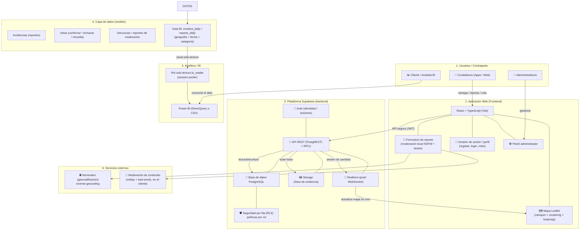

# Movimap — Arquitectura General del Sistema

> Documento de referencia para contrapartes (negocio / alianzas).
> Explica **qué** hace el sistema, **cómo** se conectan sus partes y
> **dónde** viven los datos, en lenguaje no técnico.

> 💡 **Para una presentación:** usa el diagrama de **lámina** listo para
> diapositiva en `docs/arquitectura-general-lamina.svg` (16:9, con logos de cada
> componente). El diagrama de la sección 2 es la versión detallada para lectura.

---

## 1. ¿Qué es Movimap?

Movimap es una plataforma digital para **reportar incidencias de accesibilidad
urbana** en Chile (veredas cortadas, rampas bloqueadas o inexistentes, falta de
iluminación, obstáculos, ascensores fuera de servicio, etc.).

A partir de los **reportes de la comunidad** (geo-referenciados con fotos,
categoría y descripción), Movimap genera un **producto de datos** que se entrega
a clientes institucionales para que **midan, prioricen y decidan** sobre el
espacio público mediante herramientas de analítica (p. ej. **Power BI**).

En otras palabras: **la comunidad reporta → Movimap organiza los datos → los
clientes los consumen para decidir.**

---

## 2. Diagrama de arquitectura (vista general)



---

## 3. Capas y componentes (explicación)

### 1. Usuarios
- **Ciudadanos:** usan la web desde el navegador (desktop o móvil). Pueden ver
  el mapa público sin registrarse; para reportar, votar o denunciar necesitan
  una cuenta.
- **Administradores:** gestionan y moderan los reportes desde un panel.
- **Clientes / analistas:** consumen el producto de datos (Power BI, CSV).

### 2. Aplicación web (frontend)
- **React + TypeScript** (empaquetado con *Vite*): la interfaz que ve el usuario.
- **Mapa interactivo (Leaflet):** carga los reportes **por zona visible**
  (viewport) y usa **clustering** y **mapa de calor** para mostrar miles de
  reportes sin degradar el rendimiento. Se actualiza en tiempo real por push.
- **Formulario de reporte:** captura ubicación, categoría, severidad, descripción
  y foto. En el propio navegador se **modera** el contenido (fotos NSFW y texto
  ofensivo) antes de guardar.
- **Panel de administración:** moderación y gestión del contenido.

### 3. Plataforma backend (Supabase)
- **PostgreSQL:** donde vive toda la información.
- **Auth:** registro, inicio de sesión, recuperación de contraseña, roles.
- **Storage:** almacenamiento de las fotos de evidencia (sin datos personales
  en la ruta).
- **Realtime:** envía actualizaciones a la web por WebSocket (sin consultas
  repetidas), para que el mapa refleje los cambios al instante.
- **API REST + funciones (RPCs):** el punto de acceso del frontend a los datos
  (consulta por zona, reportes cercanos, votos, etc.).
- **Seguridad por fila (RLS):** cada usuario solo ve/no modifica lo que le
  corresponde según su rol. Es la capa de protección principal en la base.

### 4. Capa de datos (modelo)
- **Incidencias:** los reportes (ubicación, categoría, severidad, foto, fecha).
- **Votos:** confirmaciones (`up`), rechazos (`down`) y marca de resuelto, que
  además controlan la **visibilidad** (un reporte con demasiados rechazos se
  oculta automáticamente, pero permanece en el análisis).
- **Denuncias:** moderación y control de calidad del contenido.
- **Vista BI:** una lectura derivada (sin duplicar datos) enriquecida con
  geografía (comuna/provincia/región), categoría y fecha/hora, lista para
  analítica.

### 5. Analítica / BI
- El cliente se conecta con un **rol de solo lectura** (`bi_reader`) mediante un
  conector dedicado, usando **DirectQuery** (lectura directa del dato más
  reciente) o **exportación CSV**.
- La vista BI se actualiza **en tiempo real** al estar construida sobre las
  tablas base, sin procesos ETL que la desfasen.

### 6. Servicios externos
- **Nominatim:** convierte una dirección en coordenadas (y viceversa) al
  reportar, para guardar comuna/calle/número.
- **Moderación de contenido:** clasificación de imágenes NSFW y filtrado de
  texto ofensivo, ejecutada en el navegador (sin enviar contenido a un API
  externo, mayor privacidad).

---

## 4. Flujo de datos (qué pasa al reportar)

```
Ciudadano llena el reporte
   → el navegador modera texto/foto (nsfw + malas palabras)
   → se resuelve la dirección a coordenadas y geografía (Nominatim)
   → se guarda la incidencia + foto en Supabase
   → la vista BI se actualiza al instante
   → el mapa muestra el nuevo reporte (push en vivo)
   → los clientes lo ven en sus tableros de analítica
```

---

## 5. Consideraciones clave para el negocio

- **Modelo de negocio:** venta de **información** geo-referenciada (no
  dashboards propios). El valor está en el **dato limpio**, **actualizado** y
  **geolocalizado**.
- **Privacidad:** la vista pública y la entrega BI **no exponen** datos
  personales de los reportantes; las fotos se guardan sin PII y el rol de
  lectura es de acceso restringido.
- **Escalabilidad:** el mapa usa carga por zona + clustering/heatmap, por lo que
  soporta volúmenes grandes de reportes.
- **Seguridad:** control de acceso por rol (RLS), auditoría y controles alineados
  con buenas prácticas de seguridad de la información.

---

*Documento de arquitectura — Movimap. Para la versión técnica detallada y el
diccionario de datos ver `docs/arquitectura-datos-decisiones.md` y
`docs/data-dictionary.md`.*
